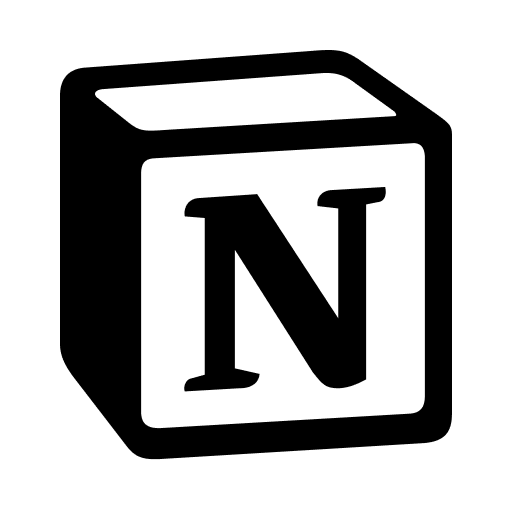

# LimeA 插件汇总仓库

这里汇总 LimeA 插件的源码、说明、授权和当前正式安装包。LimeA「设置 → 插件市场」从本仓库的 `main` 分支读取 `catalog.json`；每个插件在当前目录中只保留一份正式安装包，历史版本保留在 Git 历史中。

<!-- plugins:start -->

<!-- prettier-ignore -->
| 序号 | 图标 | 名称 | 作者 | 协议 | 源码／原仓库 | 文档 |
| --- | --- | --- | --- | --- | --- | --- |
| 1 |  | 壁纸与玻璃外观 | Playa | [MIT](plugins_dev/appearance.wallpaper/LICENSE) · [素材说明](plugins_dev/appearance.wallpaper/ASSETS.md) | [本仓库](plugins_dev/appearance.wallpaper) | [说明](plugins_dev/appearance.wallpaper/README.md) |
| 2 |  | GitHub | Playa | [MIT](plugins_dev/connectors.github/LICENSE) | [本仓库](plugins_dev/connectors.github) | [说明](plugins_dev/connectors.github/README.md) |
| 3 |  | Gmail（待谷歌认证） | Playa | [MIT](plugins_dev/connectors.gmail/LICENSE) | [本仓库](plugins_dev/connectors.gmail) | [说明](plugins_dev/connectors.gmail/README.md) |
| 4 |  | Notion | Playa | [MIT](plugins_dev/connectors.notion/LICENSE) | [本仓库](plugins_dev/connectors.notion) | [说明](plugins_dev/connectors.notion/README.md) |
| 5 |  | 你画我猜 | Playa | [MIT](plugins_dev/games.draw_guess/LICENSE) · [素材说明](plugins_dev/games.draw_guess/ASSETS.md) | [本仓库](plugins_dev/games.draw_guess) | [说明](plugins_dev/games.draw_guess/README.md) |
| 6 |  | 五子棋 | Playa | [MIT](plugins_dev/games.gomoku/LICENSE) · [素材说明](plugins_dev/games.gomoku/ASSETS.md) | [本仓库](plugins_dev/games.gomoku) | [说明](plugins_dev/games.gomoku/README.md) |
| 7 |  | 鲨鱼咬牙 | Playa | [MIT](plugins_dev/games.shark/LICENSE) · [素材说明](plugins_dev/games.shark/ASSETS.md) | [本仓库](plugins_dev/games.shark) | [说明](plugins_dev/games.shark/README.md) |

<!-- plugins:end -->

表格由 `entries/` 中的资料生成，添加或修改条目后运行 `npm run docs:plugins`。各插件采用自己的许可证，模型与图标等素材可能另有授权说明。

## 使用

在 LimeA 中打开插件市场，选择插件并安装，再到「管理插件」启用。启用即信任插件代码；声明的权限用于说明用途，不是沙箱。更新保持原有启用状态，重启 LimeA 后生效。

鲨鱼咬牙 0.4.2 与五子棋 0.3.2 需要支持插件接口版本 12 的 LimeA；该版本要求插件工具声明写入级别（只读、写插件自身数据或写外部服务）。启用后从 Chat 模式右侧「小游戏」打开，五子棋也可从插件管理卡片直接打开设置。具体玩法、构建和授权见对应插件文档。

你画我猜 0.2.2 需要支持插件接口版本 12 的 LimeA，以及支持图片输入的模型。包含轮流绘画、边画边猜、字数提示、闭合区域填色、绘画音效和暂停恢复；旧版主程序需要先更新，安装插件不能补齐宿主共享画板与私有模型能力。

## 仓库结构

```text
icons/<插件标识>/<版本>.png       市场图标，由打包脚本复制生成
plugins_dev/<插件标识>/          插件源码、README、LICENSE 和素材说明
plugins/<插件标识>/<版本>.zip    当前正式安装包
entries/<插件标识>.json          作者、分类、官方／社区层级、协议、源码与文档链接
scripts/                        打包、文档生成、校验和旧包清理脚本
catalog.json                    LimeA 读取的市场清单
```

源码目录中的 `node_modules/`、`dist/` 和本机产物不提交。市场图标来自插件自身的资源文件，避免另外维护一张原图。

## 轻量开发

Git 支持部分克隆与稀疏检出，可只下载开发所需的文件内容：

```sh
git clone --depth 1 --filter=blob:none --sparse https://github.com/Playa-LimeA/LimeA-Plugins.git
cd LimeA-Plugins
git sparse-checkout set plugins_dev entries scripts
```

这样工作目录不包含正式安装包与市场图标。想只开发鲨鱼插件，可以把最后一行的 `plugins_dev` 换成 `plugins_dev/games.shark`。构建需要的模型和图标仍会下载。

需要维护分发文件时，先恢复完整工作目录：`git sparse-checkout disable`。浅克隆需要更早历史时，可运行 `git fetch --unshallow`。

## 上架

需要 Node.js 24 或更高版本。先在汇总仓库根目录运行 `npm ci`，再构建对应插件：

```sh
npm --prefix plugins_dev/games.shark ci
npm --prefix plugins_dev/games.shark test
npm --prefix plugins_dev/games.shark run build
npm run pack:plugin -- plugins_dev/games.shark/dist entries/games.shark.json
npm test
npm run check -- --allow-stale
```

打包工具读取 `dist/limea.plugin.json`，生成带版本号的 ZIP 安装包、图标和 SHA-256（内容校验摘要），更新 `catalog.json` 与首页表格。条目资料包含 `author`、`description`、`category`、`license`、`repository`、`documentation`，以及可选的 `icon`（相对 dist 的图片路径）和 `assetLicense`（素材说明路径）。分类可选 `games`、`appearance`、`tools`、`other`。协议和文档字段只用于仓库展示，不改变现有宿主读取的清单格式。

发布分两步：先提交并发布新版安装包、图标、清单和源码，此时保留旧文件，让仍缓存旧清单的用户继续下载。待旧清单的缓存有效期结束后，运行以下命令并提交清理结果：

```sh
npm run prune:releases
npm run check
```

清理脚本只移除分发目录中不再被清单引用的安装包与图标，不修改源码。最终每个插件只有当前正式版本。清理前的 `--allow-stale` 只允许过渡期间存在旧文件，仍会检查资源摘要、文档和表格。正常 `npm run check` 会拒绝多余的分发文件。

应用刷新市场即可发现新版。已发布版本不能替换内容，修改时提升版本号。卸架时移除清单条目并重新生成表格，随后按相同过渡流程清理；已安装副本仍保留在用户机器上。

每个安装包应包含完整构建产物（根目录清单、入口及声明的资源），不包含 node_modules、私钥或本机配置。宿主限制压缩包和展开内容各 32 MiB、最多 5000 项。包内的第三方许可证应保留。

## 目录格式

详见 `catalog.json`。宿主只从本仓库下载相对路径资源，安装前核验内容摘要及插件标识、名称、版本、宿主版本范围和能力声明。目录不存在时显示空市场；网络错误会提示刷新。安装不自动执行新插件。

## 授权

本仓库不使用覆盖全部插件的统一许可证。插件代码以各自目录的 `LICENSE` 为准，素材以对应说明为准；市场表格给出直接链接。公共发布脚本使用 [MIT 许可证](scripts/LICENSE)。安装包必须包含插件许可证，并保留第三方版权与许可声明；打包不会改变原有权利归属。
